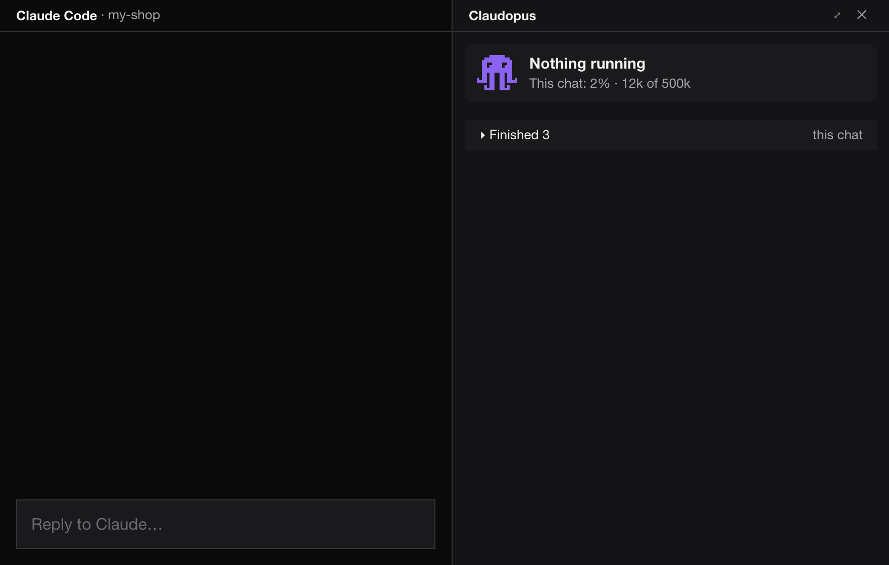

<picture>
  <source media="(prefers-color-scheme: dark)" srcset="mods/claudopus/art/banner-dark.png">
  
</picture>

<p align="center">
  <a href="https://github.com/dimka3553/claudopus/releases/latest"></a>
  <a href="https://github.com/dimka3553/claudopus/actions/workflows/check.yml"></a>
  
  <a href="LICENSE"></a>
</p>

<p align="center">
  <a href="#install">Install</a> ·
  <a href="#what-you-see">What you see</a> ·
  <a href="#settings">Settings</a> ·
  <a href="#privacy">Privacy</a> ·
  <a href="mods/claudopus/docs/guide.md">Full guide</a> ·
  <a href="https://www.claudopus.ai/changelog.html">Changelog</a> ·
  <a href="https://www.claudopus.ai">claudopus.ai</a>
</p>

**Claude Code, with eight arms.** One chat runs many pieces of work at once, on your own Mac or Linux machine.

Each message you send becomes a piece of work that runs in the background, and the chat is free for your next message straight away. A panel beside the chat shows every piece of work as a card. Working rules make Claude check its work before showing it to you, and the chat stays small, so it spends fewer tokens. It adds to Claude Code; it does not replace it. macOS and Linux · free · MIT.

Pieces of work running at once each spend their own tokens: five at a time spend about five times as fast as one. On a subscription that uses up your limits sooner; with an API key or other metered billing, it multiplies what you pay in that time.



<p align="center"><em>The panel, redrawn. The work is made up.</em></p>

## Install

At the Claude Code prompt:

```
/plugin marketplace add dimka3553/claudopus
/plugin install claudopus@claudopus
```

Answer `y` to add the marketplace, then pick the user scope (the first one, Enter).

In the desktop app: **+** next to the prompt box, **Plugins**, **Add marketplace** `dimka3553/claudopus`, then add `claudopus`.

It is on in every chat from then on. The panel opens by itself the first time work starts in a chat; `/claudopus` opens it again after you close it.

<details>
<summary>If that fails</summary>

- Over SSH, use `https://github.com/dimka3553/claudopus.git` in place of the short form.
- From a shell: `claude plugin marketplace add dimka3553/claudopus`, then `claude plugin install claudopus@claudopus`.

</details>

### Updating

Claudopus never updates by itself. Every hour (or as often as Config says) it looks at the version page on claudopus.ai, and when there is a newer version a small box in the panel's header says so, with what is new. Press **Download**, then **Install** (a copy run from a folder of the code has one **Update** press instead). The download is checked against what the release published before anything changes. Then type `/reload-plugins`, and that chat runs the new version. **Not now** hides the box for a day; **Skip this version** hides it until a newer one comes.

## What you see

### The chat and its work

- You send a message. The chat answers in one line and hands it to a background agent, then is free for your next message.
- A message about work that is already running goes to that work and steers it.
- A question that a few files answer, the chat answers itself by reading them. The chat itself never changes a file or runs a command; work does that.
- Work hands its legwork to helpers that run beside it, and keeps going while they run.

### The panel and its cards

- Every piece of work is a card: its title, its model, where it stands in a line, its to-dos as the coloured edge, and a step count. The title opens Details, with every to-do, every helper's steps and the last lines of each command. The model name can be pressed to move running work to another model. The octopus moves while anything runs.
- Helpers hang under their work's card as a tree, one row each. Commands that work leaves running (a server, a download, a long script, a watch) are rows too: what each is for, how long it has run, and how it stands, read live from its output, with how much is done of how much, the percent, the speed and the time left where it prints them. A run quiet for minutes turns amber; a run past the time it was expected to take says so. On a Mac, pressing a run opens its output in Terminal.
- Work that gets nothing new back for 12 minutes says so in amber, and the chat is told.
- **Stop** on a card holds: the card says "Stopped by you" and keeps what was done, its helpers and commands stop with it, and the chat cannot start it again until you ask for it in a new message. Details has **Start again**.
- The panel lists the work of every open chat on this machine, each under its chat's name, and of your other Macs if you name them in Settings.
- Workflows, where one agent makes and another checks it round after round, show as blue cards with a row of squares for each round.

### When work needs you

- Everything that waits for you is at the top of the panel, newest first: questions from work, admin commands, releases, password and key boxes, and Claude Code's own permission prompts, from every chat. The card turns amber and shows what it is about right under the question.
- Answer with the work's own buttons on the card. In the desktop app, **Reply in your own words** opens a reply box in the bar above the chat's prompt, named after the work it goes to; **Close** takes it away and keeps what you typed. In a terminal, the answers are numbered above the prompt.
- You also get a notification with a short sound, and the question arrives in the chat, where you can answer in your own words too.
- Once you answer, the card stays where it was for a minute, saying what you answered.

### When work is done

- The card comes to the top for two seconds, outlined in green, then goes under **Finished**. A chime plays, and a notification names the work and the start of its result; clicking it opens that chat.
- Work stopped by an error stays in its place and turns red.
- Finished work that left something running stays at the top with **Stop it**.
- When the panel is scrolled down, the bar above the prompt says what waits or what just finished at the top; pressing it takes the panel back up.

### The bar above the prompt

While work runs: memory in use, how busy the processor and graphics processor are, the battery and its time left, and the disk's and network's speed, with Claude's own part in purple. Memory turns amber past nine tenths, the battery at a fifth when on its own power. In the desktop app, resting the pointer on a figure shows its card: who uses the most, the network in and out, what the battery is drawing. In a terminal the figures are words, and some drop off when the window is narrow.

### The pages

The panel's header has these buttons:

| Page | What it holds |
| --- | --- |
| **Results** | What finished work found, newest first, with what waits on you at the top. Each opens with its pictures. |
| **Stats** | Tokens, cost at API prices, work done and time saved, from Claude Code's own records. |
| **Memory** | Opens the memory folder `~/.claude/claudopus`: your messages word for word, results, a brief for each subject, and a list of the keys you have given by name and where each is kept (never a value). |
| **Config** | Every setting, and the rules (below). Each shows what is in force and can be put back to what shipped. |
| **About** | What Claudopus is, the version this chat runs, what changed in each version, and links. |

`/claudopus` opens the panel; `/servers` lists the local servers running from your home folder and names the chat that started each, where it can.

### Rules and models

- Three short texts go into every chat and every piece of work: the **principles** (ask less, show the result, have a second agent check the work), **the chat's rules** and **the work rules**. Edit them in Config; your copy is the one used and updates never overwrite it.
- Models as shipped: Opus for most work, Sonnet for long legwork, Fable only for heavy work; each can be changed in Config. A check never runs on a weaker model than the one that built what it checks. An agent asked for an older model starts on that family's newest, and one asked for Haiku runs on Sonnet. Work the app moves to an older model after a safety flag is ended, and the work above it carries on with what is left.
- In a chat your Claude app runs on another Mac over SSH, work goes on when your Mac sleeps or the app ends the chat there: that Mac starts the chat again by itself, and the card says so.

### Keys, passwords and admin commands

- A key or token is asked for once in a box at the top of the panel and kept in the macOS keychain (on Linux, in a file only you can read). It is never put in a chat, and its value is hidden in what commands print. Work that asks for a key you already gave is told where it is.
- Before work runs a command as administrator, its card shows the exact command and the machine, with **Allow once**, **Always allow this command** and **Deny**. Config sets whether you are asked each time, once per piece of work, or never, and lists what you always allow. An admin password is never kept: each admin command asks for it, in macOS's own box on this Mac, otherwise in a box at the top of the panel.
- These boxes stop slips and common tricks; they are not a wall.

### One release at a time

Work is told to change a repo only in its own worktree and branch. It reaches main only through one release command that waits its turn, numbers the version, builds, checks and pushes, and only after you press **Allow once** on its card. A push to main by hand is refused.

Every detail is in the [full guide](mods/claudopus/docs/guide.md#what-you-see).

## Settings

Everything below is set in the panel's **Config** tab, except `macs`. It is kept in `~/.claude/claudopus/config.json`. A change made to that file, or to the rules, by anything other than Config is put back, and offered to you on a card to allow.

| Key | Default | What it does |
| --- | --- | --- |
| `name` | "the person" | What the agents call you |
| `agents` | `true` | `false` stops the handing over; each chat does its own work again |
| `sound` | `true` | `false` silences the chime and the "needs you" sound |
| `notifications` | `true` | `false` stops the notifications when work is ready, stopped or failed |
| `admin` | `each` | When you are asked before an admin command runs: `each` time, once per piece of `work`, or `never` |
| `models` | `work` opus, `legwork` sonnet, `heavy` fable | The models for most work, long legwork and heavy work |
| `updates`, `updateEvery` | every hour | How often to look for a new version: every 1, 6, 24 or 168 hours, or only when you press **Check now** |
| `macs` | none | Up to four other Macs over SSH whose chats the panel lists |

More on each in the [guide](mods/claudopus/docs/guide.md#settings).

## Needs

- macOS 12 or newer. Stats needs `jq`, which macOS 15 and later include.
- Or Linux, with Claude Code in a terminal (there is no desktop app for Linux), with the same install lines. Keys are kept in files only you can read, an admin password is asked for in the panel each time, notifications need a desktop, there is no Open in Terminal, and small copies of pictures need ImageMagick. [What differs](mods/claudopus/docs/guide.md#on-linux)
- Claude Code in a terminal or the desktop app. It is tested with 2.1.325; older versions may not draw everything.
- Not under WSL, nor where your organization blocks mods. No panel in `claude -p` or cloud sessions.
- Seen working in the macOS desktop app and in a terminal on Linux (Ubuntu 24.04); VS Code has not been tried yet. [More](mods/claudopus/docs/guide.md#needs)

## Privacy

- Everything it keeps is in `~/.claude/claudopus` on your machine. Delete the folder and it is gone.
- It sends only to Claude, through Claude Code, and to your own Macs over SSH if you name them. It reads the version page on claudopus.ai to look for updates, and downloads from GitHub only when you press Download. No telemetry.
- Keys stay in this Mac's keychain, or on Linux in files under `~/.local/share/claudopus/keyring` that only you can read. An admin password is never kept. An admin command runs only after you allow it on its card, with the system's own `PATH`.
- The two small notification apps are committed built; `mods/claudopus/notifier/checksums.txt` holds the SHA-256 of each of their files, and every release checks the committed apps still match it.

The full account of every file, hook and program is in [What Claudopus does on your Mac](mods/claudopus/docs/privacy.md).

## Turn it off

```
/plugin disable claudopus@claudopus
```

`enable` turns it back on, `uninstall` removes it. Your memory folder is left in place.

## Licence

MIT, in [LICENSE](LICENSE). Claudopus is an independent mod for Claude Code and is not affiliated with or endorsed by Anthropic.
