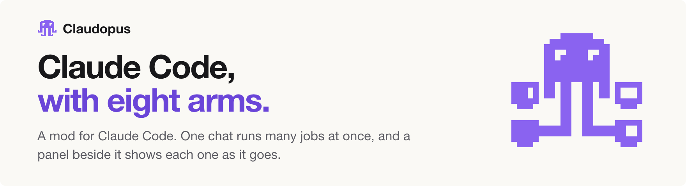
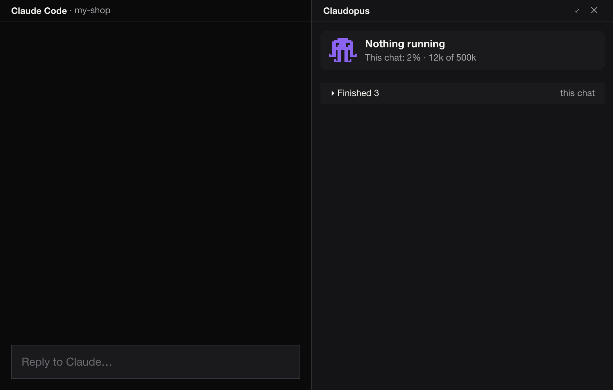

<picture>
  <source media="(prefers-color-scheme: dark)" srcset="mods/claudopus/art/banner-dark.png">
  
</picture>

<p align="center">
  <a href="https://github.com/dimka3553/claudopus/releases/latest"></a>
  <a href="https://github.com/dimka3553/claudopus/actions/workflows/check.yml"></a>
  
  <a href="LICENSE"></a>
</p>

<p align="center">
  <a href="#install">Install</a> ·
  <a href="#what-it-does">What it does</a> ·
  <a href="#settings">Settings</a> ·
  <a href="#privacy">Privacy</a> ·
  <a href="mods/claudopus/docs/guide.md">Full guide</a> ·
  <a href="https://www.claudopus.ai">claudopus.ai</a>
</p>

**Claude Code, with eight arms.** One chat runs many jobs at once, on your own Mac.

You keep talking while the work runs in the background, and a panel beside the chat shows every job as a card. Its working rules make Claude check its work before it shows you, and the chat stays small, so it spends fewer tokens. It makes Claude Code better; it does not replace it. macOS · free · MIT.



<p align="center"><em>The panel, redrawn. The jobs are made up.</em></p>

## Install

At the Claude Code prompt:

```
/plugin marketplace add dimka3553/claudopus
/plugin install claudopus@claudopus
```

Answer `y` to add the marketplace, then pick the user scope (the first one, Enter).

In the desktop app: **+** next to the prompt box, **Plugins**, **Add marketplace** `dimka3553/claudopus`, then add `claudopus`.

That is all. It is on in every chat from then on, and it keeps itself up to date.

<details>
<summary>If that fails</summary>

- Over SSH, use `https://github.com/dimka3553/claudopus.git` in place of the short form.
- From a shell: `claude plugin marketplace add dimka3553/claudopus`, then `claude plugin install claudopus@claudopus`.

</details>

## What it does

| Part | What you get |
| --- | --- |
| **Background work** | Each message becomes a piece of work run by a background agent. The chat answers in one line and is free for your next message. A message about running work steers it. |
| **The panel** | Every job is a card with its to-dos and where it stands. The octopus moves while anything runs. It lists the work of every open chat on this Mac, and of your other Macs if you name them. Work that gets nothing new back for 12 minutes says so, and the chat is told; a step running for minutes shows its time; finished work that left something running says so, with Stop it. |
| **When it needs you** | The card turns amber, rises to the top and asks, with buttons or a box to answer in. You get a notification and a short sound, and the question also arrives in the chat. |
| **When it is done** | The card turns green, a chime plays, and a notification names the work. Clicking it opens that chat. |
| **Memory** | Your messages, the results and a brief per subject are kept as plain files in `~/.claude/claudopus`, so chats can stay small. |
| **Working rules** | A short set of principles goes into every chat: ask less, show the result, have a second agent check the work. Edit them in the Config tab. |
| **Models** | Opus for most work, Sonnet for long legwork, Fable only for heavy work. Checks never run on a weaker model than the one that built the work. |
| **Passwords and keys** | Asked for once in a box at the top of the panel, in every chat, kept in the macOS keychain, never put in a chat or a file. The box words itself and work is kept out of its files: this stops slips and common tricks, and is no wall. |
| **One release at a time** | Work changes a repo only in its own worktree and branch, and reaches main only through one release command that takes its turn, numbers the version, builds, checks and pushes. A push to main by hand is refused. |
| **Tabs** | Results, Stats (tokens, cost at API prices, time saved), Config and About; Memory opens the memory folder. `/claudopus` reopens a closed panel, `/servers` lists the local servers your chats started. |

Every detail is in the [full guide](mods/claudopus/docs/guide.md#what-you-see).

## Settings

Everything is set in the panel's **Config** tab, which shows what is in force and puts each back to what shipped. It writes `~/.claude/claudopus/config.json`, where every key is optional:

| Key | Default | What it does |
| --- | --- | --- |
| `name` | "the person" | What the agents call you |
| `agents` | `true` | `false` stops the handing over; each chat does its own work again |
| `sound` | `true` | `false` silences the chime and the "needs you" sound |
| `notifications` | `true` | `false` stops the notifications when work is ready, stopped or failed |
| `updates` | `true` | `false` keeps the version you have |
| `models` | `work` opus, `legwork` sonnet, `heavy` fable | The models for most work, long legwork and heavy work |
| `macs` | none | Up to four other Macs over SSH whose chats the panel lists |

More on each, and on editing the rules, in the [guide](mods/claudopus/docs/guide.md#settings).

## Needs

- macOS 12 or newer. Stats needs `jq`, which macOS 15 and later include.
- Claude Code 2.1.287 or newer, or the desktop app 2.1.286 or newer (VS Code from 2.1.299).
- Not under WSL, nor where your organization blocks mods. No panel in `claude -p` or cloud sessions.
- Seen working in the macOS desktop app; the terminal and VS Code have not been tried yet. [More](mods/claudopus/docs/guide.md#needs)

## Privacy

- Everything it keeps is in `~/.claude/claudopus` on your Mac. Delete the folder and it is gone.
- It sends only to Claude, through Claude Code, and to your own Macs over SSH if you name them. Unless `updates` is off, once an hour it reads a version number from claudopus.ai, and when it changes, Claude Code fetches the new release from GitHub. No telemetry.
- Passwords and keys stay in this Mac's keychain.

The full account of every file, hook and program is in [What Claudopus does on your Mac](mods/claudopus/docs/privacy.md).

## Turn it off

```
/plugin disable claudopus@claudopus
```

`enable` turns it back on, `uninstall` removes it. Your memory folder is left in place.

## Licence

MIT, in [LICENSE](LICENSE). Claudopus is an independent mod for Claude Code and is not affiliated with or endorsed by Anthropic.
