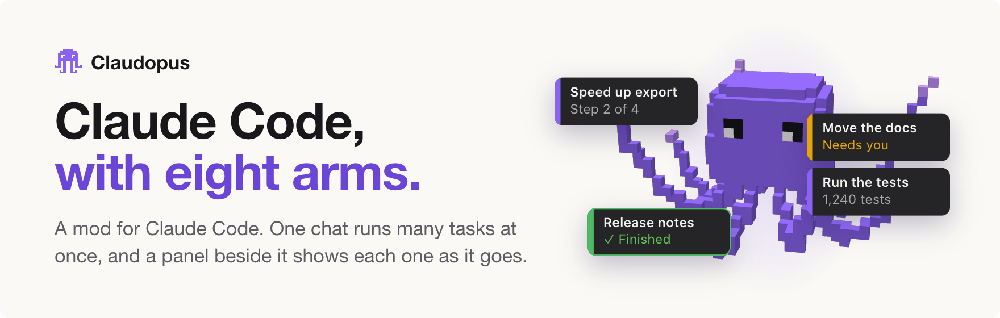
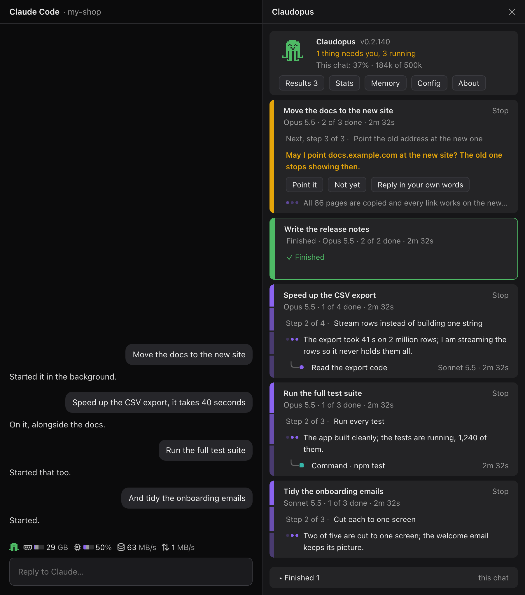

<picture>
  <source media="(prefers-color-scheme: dark)" srcset="mods/claudopus/art/banner-dark.png">
  
</picture>

<p align="center">
  <a href="https://github.com/dimka3553/claudopus/releases/latest"></a>
  <a href="https://github.com/dimka3553/claudopus/actions/workflows/check.yml"></a>
  
  <a href="LICENSE"></a>
</p>

<p align="center">
  <a href="#install">Install</a> ·
  <a href="#what-you-see">What you see</a> ·
  <a href="#settings">Settings</a> ·
  <a href="#privacy">Privacy</a> ·
  <a href="mods/claudopus/docs/guide.md">Full guide</a> ·
  <a href="https://www.claudopus.ai/changelog.html">Changelog</a> ·
  <a href="https://www.claudopus.ai">claudopus.ai</a>
</p>

**Claude Code, with eight arms.** One chat runs many tasks at once, on your own Mac or Linux machine.

Each message you send starts a task that Claude does in the background, so the chat is free for your next message straight away. A panel beside the chat shows each task as a card, and the chat stays small because the tasks run elsewhere. It adds to Claude Code. It doesn't replace it. macOS and Linux · free · MIT.

Each task uses its own tokens, so five tasks at once use tokens about five times as fast as one. On a subscription, that uses up your limits sooner. With an API key or other pay-per-use billing, it multiplies what you pay in that time.



<p align="center"><em>The panel, drawn from Claudopus's own code with made-up tasks.</em></p>

## Install

At the Claude Code prompt:

```
/plugin marketplace add dimka3553/claudopus
/plugin install claudopus@claudopus
```

Answer `y` to add the marketplace, then pick the user scope (the first one, Enter).

In the desktop app: **+** next to the prompt box, **Plugins**, **Add marketplace** `dimka3553/claudopus`, then add `claudopus`.

It is on in every chat from then on. The first time, the panel opens with a welcome and an **Bring in old chats** button that reads your past chats into its memory. After that, it opens by itself when a task starts. If you close it, it closes in every chat. Type `/claudopus` to open it again.

<details>
<summary>If that fails</summary>

- Over SSH, use `https://github.com/dimka3553/claudopus.git` in place of the short form.
- From a shell: `claude plugin marketplace add dimka3553/claudopus`, then `claude plugin install claudopus@claudopus`.

</details>

### Updating

Claudopus never updates by itself. Every hour (or as often as Config says), it checks the version page on claudopus.ai. When there's a newer version, a small box in the panel's header says so and shows what's new. Press **Download**, then **Install**. (A copy run from a folder of the code has one **Update** button instead.) Before anything changes, Claudopus checks the download against what the release published. Then type `/reload-plugins`, and that chat runs the new version. **Not now** hides the box for a day. **Skip this version** hides it until a newer version comes out.

## What you see

### The chat and its tasks

- You send a message. The chat answers in one line and starts a background task for it. Then the chat is free for your next message.
- If your message is about a task that's already running, the chat sends it to that task.
- If a few files can answer your question, the chat reads them and answers it itself. The chat changes no file. It runs only a single command that changes no file (a push of its branch, a fetch, a look with git or gh, opening a local page, a folder or a file to look at, a status check of a local server), in the background, and shows a local page in the browser pane itself. Tasks do the rest.
- A request the chat can state exactly (a described change, a push and a look at the build, a merge, a look-up) goes to a fresh task on Sonnet with written instructions. A request that needs judgment goes to a fresh task on Opus, or on Fable when it is heavy. The chat never hands a request to a copy of itself: measured on 108 requests, a copy cost 1.4 to 5.9 times as much as the Sonnet task, which was fastest in 32 of 36 cases and within 9 seconds in the rest.
- A task works in few steps: it finds every place a change touches first, makes the change in one go, and looks at a picture only when the code can't tell. No second helper checks the work unless you ask. In Config you can have one check every change, or all but small tested fixes (**Second check**).
- For long searching and reading, Claude starts helpers: more agents that run alongside it. Claude keeps going while they run.

### The panel and its cards

- Every task is a card. It shows the title, the model, how many to-dos are done, what the task made (a file to press and open, or how many code files it changed), a line on how far it has got, and the to-dos as the coloured edge. Press the title to open **Details**: every to-do, every helper's steps and the last lines each command printed. Press the model name to move a running task to another model. The octopus moves while anything is running.
- Helpers hang under their task's card as a tree, one row each. Every command a task runs for more than ten seconds (a server, a download, a long script, a wait) also gets a row. The row shows what the command is for and how long it has been running. Under it, one short plain line says what the command is doing and how far it has got, never raw output. A percent the command prints moves up on the line within seconds. If the command prints nothing for a minute, Claudopus tells Claude to look at it; after three minutes the line says so too, in amber. A command that runs past the time it was expected to take turns amber as well. **Stop** on the row ends the command, and Claudopus tells Claude the command was stuck. On a Mac, press a command to open its output in Terminal.
- If a task makes no progress for 12 minutes, its card says so in amber, and Claudopus tells the chat.
- **Stop** on a card stops the task for good. The card says "Stopped by you" and keeps what was done. Its helpers and background commands stop too. The chat can't start the task again until you ask in a new message. Details has **Start again**.
- The panel also lists other chats on this machine while they have tasks running or something waiting, each under its chat's name. It lists chats on your other Macs too, if you list them under `macs`.
- A workflow is where one agent makes something and another checks it against a test, round after round. It shows as a blue card with a row of squares for each round. Ask for one, or use the `rounds` skill.

### When a task needs you

- Everything that waits for you is at the top of the panel, newest first, from every chat: questions from Claude, admin commands, releases, password and key boxes, and Claude Code's own permission prompts. The card turns amber and shows what it's about right under the question.
- Answer with the buttons on the card. In the desktop app, **Reply in your own words** opens a reply box in the bar just above the chat's prompt, named after the task it goes to. **Close** takes the box away and saves what you typed. In a terminal, the answers to the first question are numbered above the prompt: press a number twice in the empty prompt. You answer another chat's question in that chat. Other panels show it without buttons.
- You also get a notification with a short sound, and you can answer in your own words in the chat too.
- Claude gets your reply right away, even while it's running something long. If it has to wait for a short command to finish, the card says which. A question never times out: it stays until you answer.
- After you answer, the card stays where it was for a minute and shows what you answered.

### When a task is done

- The card comes to the top, under anything waiting for you, for two seconds, outlined in green. It stays among the cards, with Change something and Dismiss, until you press **Dismiss**, which puts it under **Finished**. A chime plays, and a notification names the task and the start of its result. Click it to open that chat.
- A task that failed with an error stays in its place and turns red.
- If a finished task left something running, its card stays at the top with **Stop it**.
- When the panel is scrolled down, the bar just above the prompt says what's waiting or what just finished at the top. Press it to scroll the panel back up.

### The bar above the prompt

While tasks run, the bar shows memory in use, how busy the processor and graphics processor are, the battery and its time left, and the disk and network speed. Claude's own share is in purple. Memory turns amber past nine tenths, and the battery turns amber at a fifth when it's on its own power. In the desktop app, rest the pointer on a figure to see its card: who uses the most, the network in and out, and what the battery is drawing. In a terminal, they are short labels with small meters, and some drop off when the window is narrow.

### The pages

The panel's header has these buttons (Results once there is a result):

| Page | What it holds |
| --- | --- |
| **Results** | What finished tasks found, newest first, with what's waiting for you at the top (each with Yes, No and Not now). Each one opens with a tile for each file its task made, then its finding. |
| **Stats** | Tokens, cost at API prices, tasks done and time saved, from Claude Code's own records. |
| **Memory** | Opens the memory folder `~/.claude/claudopus`: your messages word for word, results, notes on each topic, and a list of the keys you've given by name and where each is saved (never a value). |
| **Config** | Every setting, and the rules (below). Each shows what is in force, and **Reset** puts it back to what shipped. |
| **About** | What Claudopus is, the version this chat runs, what changed in each version, and links. |

`/claudopus` opens the panel; `/servers` lists the local servers running from your home folder and names the chat that started each, where it can.

### Rules and models

- Three short texts guide the agents. The **principles** (ask less, build it once, show the result) go into every chat and every task. **The chat's rules** go into the chat, and **the task rules** go into tasks. Edit them in Config. Claudopus uses your copy, and updates never overwrite it. A change to them, to the models or to the second check reaches new chats and new tasks. An open chat and a running task keep the rules they started with, through an update too.
- The models Claudopus starts with: Opus for most tasks, Sonnet for requests the chat can state exactly and for long searching and reading, Fable only for heavy tasks. You can change each in Config. A helper that checks a task's work runs on at least the model that did the work, and never below Opus. If an agent asks for an older model, it starts on the newest model of that family. If it asks for Haiku, it runs on Sonnet, unless you chose Haiku in Config. If the app moves a task to an older model after a safety flag, Claudopus ends that task, and the task above it continues with what is left.

### Keys, passwords and admin commands

- Claudopus asks for a key or token once, in a box at the top of the panel, and saves it in the macOS keychain (on Linux, in a file only you can read). It is never put in a chat, and its value is hidden in anything a command prints. If Claude asks for a key you've already given, Claudopus tells Claude where it is.
- Before Claude runs a command as administrator, the task's card shows the exact command and the machine, with **Allow once** (or **Allow for this task**), **Always allow this command** and **Deny**. In Config you choose whether Claudopus asks each time, once per task, or never. Config also lists what you always allow. Claudopus never saves an admin password. Each admin command asks for it, in macOS's own box on this Mac, or otherwise in a box at the top of the panel.
- These boxes catch mistakes and common tricks, but code running as you on your machine could still get around them.

### One release at a time

Claudopus tells Claude to change a repo only in the task's own worktree and branch. A task reaches main only through one release command. The command waits its turn, numbers the version, builds, checks and pushes, and only after you press **Allow once** on its card. Claudopus refuses a task's own push to main.

Every detail is in the [full guide](mods/claudopus/docs/guide.md#what-you-see).

## Settings

You set everything below in the panel's **Config** tab, except `macs`. Claudopus saves it in `~/.claude/claudopus/config.json`. If that file or the rules change any other way, Claudopus holds the change. When Claude edits one, a card asks you first. Any other change is undone, and a card offers it to you.

| Key | Default | What it does |
| --- | --- | --- |
| `name` | "the person" | What the agents call you |
| `agents` | `true` | `false` turns off background tasks; each chat does its own work again |
| `sound` | `true` | `false` silences the chime and the "needs you" sound |
| `notifications` | `true` | `false` stops the notifications when a task is done, stopped or failed |
| `admin` | `each` | When you are asked before an admin command runs: `each` time, once per task (`work`), or `never` |
| `models` | `work` opus, `legwork` sonnet, `heavy` fable | The models for most tasks, clearly stated jobs with long searching and reading, and heavy tasks |
| `lean` | `fable` heavy, `second` asked | When Fable runs (`heavy`, `all` or `named`) and when a second helper checks (`asked`, `beyond`: all but small tested fixes, `every`) |
| `updates`, `updateEvery` | every hour | How often to look for a new version: every 1, 6, 24 or 168 hours, or only when you press **Check now** |
| `macs` | none | Up to four other Macs over SSH whose chats the panel lists ([how](mods/claudopus/docs/guide.md#settings)) |

More on each in the [guide](mods/claudopus/docs/guide.md#settings).

## Needs

- macOS 12 or newer. Stats needs `jq`, which macOS 15 and later include.
- Or Linux, with Claude Code in a terminal (there is no desktop app for Linux), with the same install lines. Keys are saved in files only you can read, an admin password is asked for in the panel each time, notifications need a desktop, there is no Open in Terminal, and small copies of pictures need ImageMagick. [What differs](mods/claudopus/docs/guide.md#on-linux)
- Claude Code in a terminal or the desktop app. It is tested with 2.1.325; older versions may not draw everything.
- Not under WSL, nor where your organization blocks mods. No panel in `claude -p` or cloud sessions.
- Seen working in the macOS desktop app and in a terminal on Linux (Ubuntu 24.04); VS Code has not been tried yet. [More](mods/claudopus/docs/guide.md#needs)

## Privacy

- Everything Claudopus saves is in `~/.claude/claudopus` on your machine. Delete the folder and it's gone.
- Claudopus sends data only to Claude, through Claude Code, and to your own Macs over SSH if you name them. It reads the version page on claudopus.ai to check for updates, and it contacts GitHub only when you press Download or Install. There is no telemetry.
- Keys stay in this Mac's keychain, or on Linux in files under `~/.local/share/claudopus/keyring` that only you can read. Claudopus never saves an admin password. An admin command runs only after you allow it on its card, with the system's own `PATH`.
- The two small notification apps are committed built; `mods/claudopus/notifier/checksums.txt` holds the SHA-256 of each of their files, and every release checks the committed apps still match it.

The full account of every file, hook and program is in [What Claudopus does on your Mac](mods/claudopus/docs/privacy.md).

## Turn it off

```
/plugin disable claudopus@claudopus
```

`enable` turns it back on, `uninstall` removes it. Your memory folder is left in place.

## Licence

MIT, in [LICENSE](LICENSE). Claudopus is an independent mod for Claude Code and is not affiliated with or endorsed by Anthropic.
