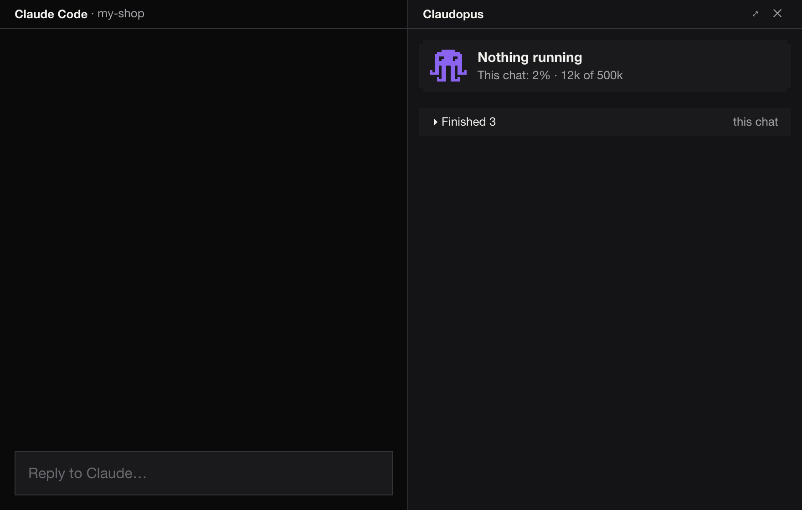

# Claudopus

A mod for Claude Code. Each chat hands its work to background agents, so you keep talking while the work runs.
A panel beside the chat shows each piece of work with its to-dos, and an octopus moves while anything runs.
Your messages, the results and a brief per subject are kept in a memory folder, so chats can stay small.



*The panel during a real session, sped up.*

## Install

In a terminal, at the Claude Code prompt:

```
/plugin marketplace add dimka3553/claudopus
/plugin install claudopus@claudopus
```

Answer `y` to add the marketplace, then pick the user scope (the first one, Enter). If the short form fails over SSH, use `https://github.com/dimka3553/claudopus.git` in its place. From a shell, the same two steps are `claude plugin marketplace add dimka3553/claudopus` and `claude plugin install claudopus@claudopus`.

In the Claude desktop app: click + next to the prompt box, then Plugins, Add marketplace with `dimka3553/claudopus`, then add the plugin `claudopus`.

That is all. Nothing has to be typed in each chat.

## What you see

- The mod is on in every chat you open from then on, in every folder.
- You send a message. The chat answers in one line and starts a background agent for it, then is free for your next message.
- The panel opens beside the chat by itself the first time work starts in that chat. Each piece of work is a card with its to-dos and a line saying where it stands. If you close the panel it stays closed for that chat; `/claudopus` opens it again.
- A short band above the prompt says what is being done right now.
- A message about work that is already running goes to that work as a steer instead of starting new work.
- When work finishes, the chat passes on its result, and the panel lists it under Finished. What the work left for you to read is listed under Results.
- Stats, beside Results, adds up what the work came to, for this chat or every chat with kept work, today or all time: tokens by model, work finished, to-dos done, your messages, the time saved by running work side by side, a timeline, what the tokens would cost at API prices, and what the memory holds.
- Memory, at the top of the panel, opens Finder at the folder where Claudopus keeps what it remembers.
- About, beside Memory, waves hello once, says what Claudopus is and shows its version and Claude Code's, the website, the licence and the GitHub repo.
- A finish plays a short quiet chime, and a notification names the work and the first words of its result, so you hear and see it when you are elsewhere.
- When work needs an admin command, a box asks you once for that Mac's password, hiding what you type; it stays in this Mac's keychain and work never sees it.
- When work needs a key, token or password, a box asks you once for it by name, hiding what you type; it stays in this Mac's keychain, work uses it as an environment variable, and it is hidden from every output.
- `/servers` shows the local servers running on your machine and which chat started each.

The mod also adds a short set of working principles ([mods/claudopus/rules/CLAUDE.md](rules/CLAUDE.md)) to every chat. They shape how Claude answers; change them to fit you in the Config tab.

The chat picks a model for each piece of work: Opus for most, Sonnet for long legwork, Fable only for heavy work. Your account needs access to the model it picks.

## Needs

- Claude Code 2.1.287 or newer in the terminal, or the desktop app 2.1.286 or newer. The panel draws in VS Code from 2.1.299.
- Does not work on Windows under WSL (plugins do not load there) or where your organization's admins block mods. In `claude -p` print mode and cloud sessions there is no panel.
- Stats reads Claude's records with `jq`, which macOS 15 and later include.
- Seen working in the macOS desktop app. The terminal and VS Code have not been tried yet.

## Settings

The panel's Config tab lists everything you can set, shows what is in force, and puts each back to what shipped. Edit on the principles, the chat's rules or the work rules makes your own copy at the same path under `~/.claude/claudopus` (`rules/CLAUDE.md`, `roles/chat.md`, `roles/work.md`); the mod uses your copy when there is one, and an update never touches it.

The settings are `~/.claude/claudopus/config.json`. Every key is optional:

```json
{ "name": "Sam", "agents": true, "sound": true, "notifications": true, "models": { "work": "opus", "legwork": "sonnet", "heavy": "fable" } }
```

- `name`: what the agents call you. Left out, they say "the person".
- `agents`: `false` stops the handing over; every chat then does its own work again.
- `sound`: `false` silences the short chime played when work is ready.
- `notifications`: `false` stops the notification that names work when it is ready, stopped or failed.
- `models`: which model runs most work, long legwork and helpers, and heavy work (`opus`, `sonnet`, `fable` or `haiku`).

`name` and `agents` are read when a chat starts; `sound` and `notifications` each time work ends.

## Turn it off

```
/plugin disable claudopus@claudopus
```

`/plugin enable claudopus@claudopus` turns it back on; `/plugin uninstall claudopus@claudopus` removes it. Your memory folder is left in place.

## Memory

Everything the mod keeps is in `~/.claude/claudopus`, as plain files:

- `index.md`: the subjects of your work, one line each
- `streams/`: one brief per subject
- `words/`: your messages, word for word, one file per chat
- `reports/`: what finished work left for you, one dated folder each
- `asks/`: what you asked in each chat and what was done, one file per chat
- `finished/`: the Finished list of each chat
- `servers.json`: the servers `/servers` last saw
- `log.md`: the mod's own log

Delete the folder to start over.

## What it runs and sends

Everything stays on your machine, apart from what Claude Code itself sends to Claude:

- After each reply, one short Sonnet call through Claude Code titles the chat and notes what was asked and done.
- It reads Claude Code's own session records under `~/.claude` to show work and Stats, and writes only under `~/.claude/claudopus`.
- It runs local commands: `lsof` and `ps` for `/servers`, `kill` when you stop a server there, `jq` and `du` for Stats, `sips` for picture thumbnails, `osascript` for notifications and the password and key boxes, `security` for the keychain, `open` for Finder and files, and `grep` to search the memory.
- The admin and key runners (`bin/admin`, `bin/secret`) run only the command work hands them, on this Mac or over SSH to a host it names, and never send a password or key anywhere else.

No telemetry, no other network calls.

## Licence

MIT, in [LICENSE](LICENSE). Claudopus is an independent mod for Claude Code and is not affiliated with or endorsed by Anthropic.
